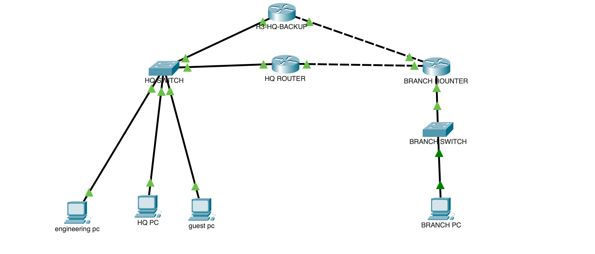

# Cisco Enterprise Multi-Site Network Lab

## Project Overview
## Network Topology

This project demonstrates the design, implementation, and troubleshooting of a simulated enterprise network using Cisco Packet Tracer.

The lab connects a Headquarters (HQ) network to a Branch network using OSPF dynamic routing. It also implements VLAN segmentation, inter-VLAN routing, DHCP, access control lists (ACLs), and HSRP gateway redundancy.

**Platform:** Cisco Packet Tracer  
**Project Type:** Networking / Infrastructure / Troubleshooting  
**Focus:** Cisco Network Engineering

## Network Architecture

The network consists of:

- **R1:** HQ primary router and DHCP server
- **R2:** Branch router
- **R3:** HQ backup router
- **SW1:** HQ access switch
- **Branch switch:** Branch LAN connectivity
- **End devices:** Management, Engineering, Guest, and Branch PCs

R1 and R3 provide HSRP gateway redundancy for the HQ VLANs. R2 connects to both routers through separate WAN links.

## IP Addressing

| Network | Subnet | Gateway |
|---|---|---|
| Management — VLAN 10 | 192.168.10.0/24 | 192.168.10.254 |
| Engineering — VLAN 20 | 192.168.30.0/24 | 192.168.30.254 |
| Guest — VLAN 30 | 192.168.40.0/24 | 192.168.40.254 |
| Branch LAN | 192.168.20.0/24 | 192.168.20.1 |
| Primary WAN | 10.0.0.0/30 | R1–R2 |
| Backup WAN | 10.0.0.4/30 | R3–R2 |

## Technologies Implemented

### 1. OSPF Dynamic Routing
- Configured OSPF Area 0 across three routers.
- Established OSPF neighbor adjacencies.
- Advertised HQ and Branch networks.
- Verified route learning and backup WAN connectivity.

### 2. VLANs and Inter-VLAN Routing
- Created Management, Engineering, and Guest VLANs.
- Configured 802.1Q trunking.
- Implemented router-on-a-stick using Cisco subinterfaces.
- Verified communication between authorized VLANs.

### 3. Network Security — ACLs
- Configured extended ACLs to restrict Guest network access.
- Blocked Guest traffic to Management, Engineering, and Branch networks.
- Applied matching Guest ACL policies to the primary and backup HQ routers.
- Verified authorized Engineering traffic remained functional.

### 4. DHCP
- Configured separate DHCP pools for HQ VLANs.
- Excluded reserved IP address ranges.
- Distributed IP addresses and default gateways automatically.
- Updated DHCP gateway options to use HSRP virtual IP addresses.

### 5. HSRP and WAN Redundancy
- Configured R1 as the preferred HSRP Active router.
- Configured R3 as the Standby router.
- Implemented virtual gateways for three HQ VLANs.
- Added an alternative WAN connection between R3 and R2.
- Tested connectivity through the backup router while R1 was powered off.

## Testing and Verification

The following tests were performed during the lab:

| Test | Result |
|---|---|
| HQ-to-Branch connectivity | Passed |
| OSPF neighbor adjacency | Passed |
| Inter-VLAN connectivity | Passed |
| Guest ACL restrictions | Passed |
| DHCP address assignment | Passed |
| HSRP Active/Standby operation | Passed |
| R3 backup WAN connectivity | Passed |
| Engineering-to-Branch connectivity during R1 failure | Passed after gateway correction |

## Troubleshooting Experience

### Case 1 — Incorrect Router Interface Mapping

**Issue:** Direct router-to-router ping failed despite interfaces showing up/up.

**Investigation:** Used `show cdp neighbors` to identify the actual physical connections.

**Resolution:** Corrected the IP address assignments to match the connected interfaces.

### Case 2 — Incorrect Engineering PC IP Address

**Issue:** Engineering PC could not reach its VLAN gateway.

**Investigation:** Checked VLAN assignments, trunk configuration, router interfaces, and PC IP configuration.

**Resolution:** Corrected the Engineering PC IP address to the appropriate subnet.

### Case 3 — HSRP Failover Connectivity Failure

**Issue:** Engineering PC could reach the backup router but could not reach the Branch network after R1 was powered off.

**Investigation:** Verified HSRP, OSPF routing tables, extended ping results, and PC default gateway settings.

**Root Cause:** Engineering PC was still using R1's physical IP address as its default gateway.

**Resolution:** Changed the default gateway to the HSRP virtual IP and verified successful connectivity during failover.

## Known Limitations

- DHCP service is hosted on R1 and is not fully redundant.
- The HQ switch remains a single point of failure.
- Internet connectivity and NAT/PAT are outside the scope of this version.
- The lab is a Packet Tracer simulation, not a production deployment.

## Project File

Open `Cisco-Enterprise-Multisite-hsrp-complete.pkt` using Cisco Packet Tracer to inspect the topology and configurations.

## Skills Demonstrated

Cisco IOS CLI · IPv4 Subnetting · OSPF · VLANs · 802.1Q Trunking · Inter-VLAN Routing · ACLs · DHCP · HSRP · Network Troubleshooting · High Availability

---

**Purpose:** Hands-on networking portfolio project demonstrating practical Cisco configuration, troubleshooting, and network redundancy concepts.

## Troubleshooting Documentation

Detailed troubleshooting cases and resolutions are available here:

[View Network Troubleshooting Documentation](docs/troubleshooting.md)
